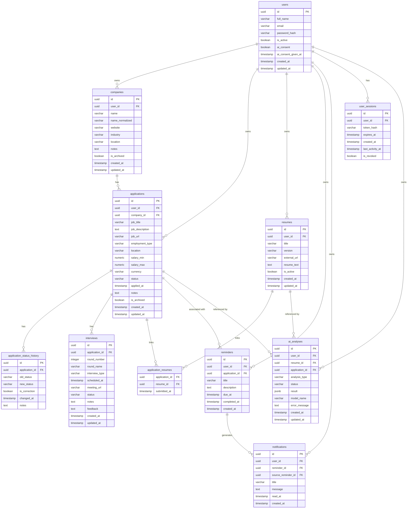
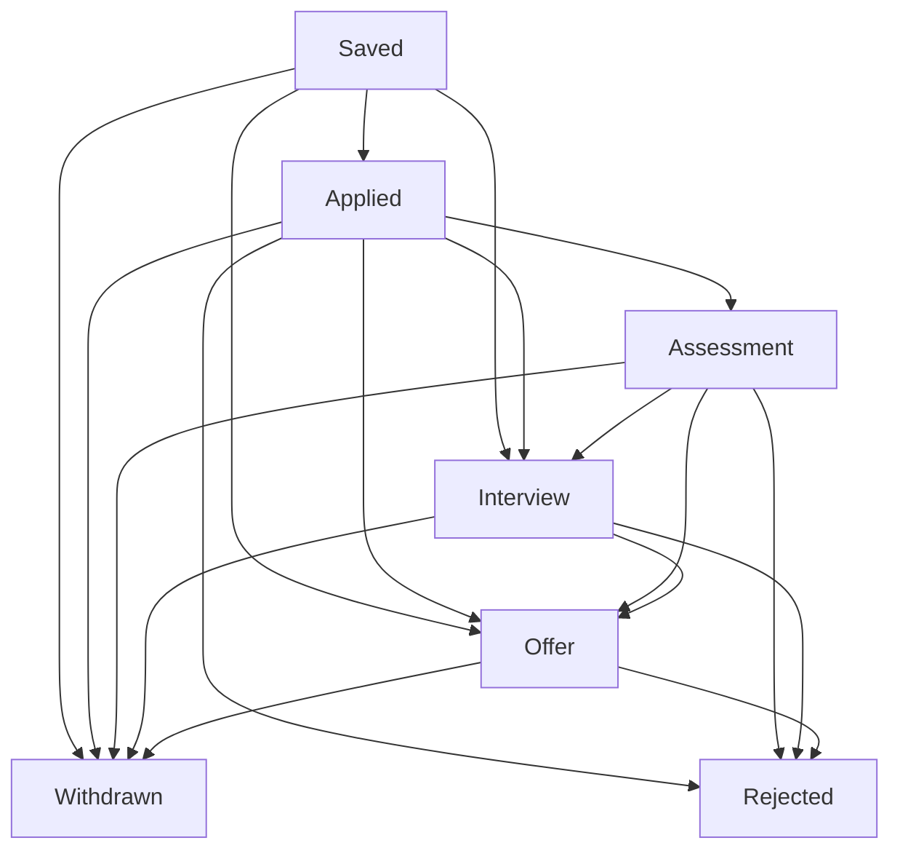

# ApplyTrack — Database Design
## Phase 0: Schema Review and Finalization

> Database: PostgreSQL | ORM: SQLAlchemy 2.x | Migrations: Alembic

---

## 1. Design Principles

### UUID Primary Keys

All tables use UUID v4 primary keys generated by the application (or by PostgreSQL's `gen_random_uuid()`). UUIDs are non-sequential and non-guessable, which reduces the risk of enumeration attacks where an attacker increments integer IDs to discover records. UUIDs do **not** replace authorization checks — every read, write, and delete must still verify that the requesting user owns the record.

### UTC Timestamps

All `TIMESTAMP` columns store values in UTC with no timezone offset. The application layer is responsible for converting UTC to the user's local timezone for display. This avoids daylight-saving ambiguities in stored data. Columns use PostgreSQL type `TIMESTAMP WITH TIME ZONE` (aliased `TIMESTAMPTZ`) to make the UTC intent explicit and to allow PostgreSQL to normalize any input.

### Ownership Model

Every user-owned entity carries a `user_id UUID NOT NULL REFERENCES users(id)` column. All service-layer queries filter by `user_id` in addition to the entity's primary key. Never query a record by ID alone and assume the caller has access. For entities that do not have a direct `user_id` column (e.g., `interviews`, `application_status_history`), ownership is established by JOINing through the parent `applications` table, and the service layer must enforce this explicitly.

### Soft-Delete / Archiving

Records that represent meaningful historical activity (applications, companies) are never hard-deleted by default. Instead, an `is_archived BOOLEAN NOT NULL DEFAULT FALSE` flag removes them from default list views while retaining the data for audit, analytics, and future reference. Hard-delete is permitted only under explicitly defined conditions (see Section 7).

### Naming Conventions

- Table names: lowercase plural snake_case (`applications`, `application_status_history`).
- Column names: lowercase snake_case.
- Indexes: `idx_{table}_{column(s)}`.
- Unique constraints: `uq_{table}_{column(s)}`.
- Foreign keys: named after the referenced table, e.g., `user_id`, `application_id`.

---

## 2. ER Diagram



---

## 3. Table Definitions

### 3.1 users

Stores registered user accounts. The central ownership anchor for all other tables.

| Column | Type | Nullable | Default | Notes |
|---|---|---|---|---|
| `id` | `UUID` | NOT NULL | `gen_random_uuid()` | Primary key |
| `full_name` | `VARCHAR(255)` | NOT NULL | — | Display name |
| `email` | `VARCHAR(320)` | NOT NULL | — | Login identifier; RFC 5321 max length |
| `password_hash` | `VARCHAR(255)` | NOT NULL | — | Argon2id hash; never plaintext |
| `is_active` | `BOOLEAN` | NOT NULL | `TRUE` | FALSE = soft-deactivated |
| `ai_consent` | `BOOLEAN` | NOT NULL | `FALSE` | Has user consented to AI analysis? |
| `ai_consent_given_at` | `TIMESTAMPTZ` | NULL | — | When consent was given |
| `created_at` | `TIMESTAMPTZ` | NOT NULL | `now()` | Account creation time |
| `updated_at` | `TIMESTAMPTZ` | NOT NULL | `now()` | Last profile update |

**Primary Key:** `id`

**Unique Constraints:**
- `uq_users_email`: `(email)`

**Indexes:**
- `idx_users_email`: `(email)` — login lookup

**CHECK Constraints:** None additional.

**ON DELETE:** This is the root table. Deleting a user cascades to all owned records (see Section 7).

---

### 3.2 companies

Private company directory, one per user. A user may have many companies; a company may have many applications.

| Column | Type | Nullable | Default | Notes |
|---|---|---|---|---|
| `id` | `UUID` | NOT NULL | `gen_random_uuid()` | Primary key |
| `user_id` | `UUID` | NOT NULL | — | FK → users.id |
| `name` | `VARCHAR(255)` | NOT NULL | — | Display name as entered |
| `name_normalized` | `VARCHAR(255)` | NOT NULL | — | Lowercase, trimmed; used for uniqueness |
| `website` | `VARCHAR(2048)` | NULL | — | Company website URL |
| `industry` | `VARCHAR(100)` | NULL | — | Industry category |
| `location` | `VARCHAR(255)` | NULL | — | City, country, or region |
| `notes` | `TEXT` | NULL | — | Personal notes about the company |
| `is_archived` | `BOOLEAN` | NOT NULL | `FALSE` | Soft-delete flag |
| `created_at` | `TIMESTAMPTZ` | NOT NULL | `now()` | Record creation time |
| `updated_at` | `TIMESTAMPTZ` | NOT NULL | `now()` | Last update time |

**Primary Key:** `id`

**Foreign Keys:**
- `user_id` → `users(id)` ON DELETE CASCADE

**Unique Constraints:**
- `uq_companies_user_name_normalized`: `(user_id, name_normalized)` — prevents duplicate company names per user

**Indexes:**
- `uq_companies_user_name_normalized`: `(user_id, name_normalized)` — UNIQUE; prevents duplicate company names per user and covers prefix lookups on `user_id`
- `idx_companies_user_id_is_archived_name`: `(user_id, is_archived, name ASC)` — filter archived/active companies for a user and cover exact `ORDER BY name ASC` sorting without in-memory filesort

**CHECK Constraints:** None additional.

**Application note:** `name_normalized` is computed in the service layer before insert/update: `name.strip().lower()`. It is stored to avoid repeated computation on every uniqueness check.

---

### 3.3 applications

The core entity. Represents one job application for one role at one company.

| Column | Type | Nullable | Default | Notes |
|---|---|---|---|---|
| `id` | `UUID` | NOT NULL | `gen_random_uuid()` | Primary key |
| `user_id` | `UUID` | NOT NULL | — | FK → users.id; ownership anchor |
| `company_id` | `UUID` | NOT NULL | — | FK → companies.id |
| `job_title` | `VARCHAR(255)` | NOT NULL | — | Role title |
| `job_description` | `TEXT` | NULL | — | Full job posting text |
| `job_url` | `VARCHAR(2048)` | NULL | — | Link to original job posting |
| `employment_type` | `VARCHAR(50)` | NULL | — | See enum in Section 4 |
| `location` | `VARCHAR(255)` | NULL | — | Role location |
| `salary_min` | `NUMERIC(12,2)` | NULL | — | Minimum of range |
| `salary_max` | `NUMERIC(12,2)` | NULL | — | Maximum of range |
| `currency` | `VARCHAR(10)` | NULL | `'USD'` | ISO 4217 currency code |
| `status` | `VARCHAR(50)` | NOT NULL | `'Saved'` | Current lifecycle status; see enum |
| `applied_at` | `TIMESTAMPTZ` | NULL | — | When the application was submitted |
| `notes` | `TEXT` | NULL | — | Personal notes |
| `is_archived` | `BOOLEAN` | NOT NULL | `FALSE` | Soft-delete flag |
| `created_at` | `TIMESTAMPTZ` | NOT NULL | `now()` | Record creation time |
| `updated_at` | `TIMESTAMPTZ` | NOT NULL | `now()` | Last update time |

**Primary Key:** `id`

**Foreign Keys:**
- `user_id` → `users(id)` ON DELETE CASCADE
- `company_id` → `companies(id)` ON DELETE RESTRICT — prevent deleting a company that has applications

**Unique Constraints:** None.

**Indexes:**
- `idx_applications_user_id_status`: `(user_id, status)` — filter by status; covers generic prefix lookups on `user_id`
- `idx_applications_user_id_applied_at`: `(user_id, applied_at DESC)` — sort by application date
- `idx_applications_company_id`: `(company_id)` — list applications for a company; foreign key join performance

**CHECK Constraints:**
```sql
CHECK (status IN ('Saved', 'Applied', 'Assessment', 'Interview', 'Offer', 'Rejected', 'Withdrawn'))
CHECK (employment_type IS NULL OR employment_type IN ('Full-time', 'Part-time', 'Contract', 'Freelance', 'Internship', 'Temporary'))
CHECK (salary_min IS NULL OR salary_max IS NULL OR salary_min <= salary_max)
CHECK (salary_min IS NULL OR salary_min >= 0)
CHECK (salary_max IS NULL OR salary_max >= 0)
```

**Service-layer invariant:** `applications.company_id` must reference a company whose `user_id` matches `applications.user_id`. This cross-column ownership check is enforced in the service layer, not by a database constraint, and must be tested explicitly.

---

### 3.4 application_status_history

Immutable audit trail of every status change for an application. Never update or delete rows in this table.

| Column | Type | Nullable | Default | Notes |
|---|---|---|---|---|
| `id` | `UUID` | NOT NULL | `gen_random_uuid()` | Primary key |
| `application_id` | `UUID` | NOT NULL | — | FK → applications.id |
| `old_status` | `VARCHAR(50)` | NULL | — | NULL for initial status set |
| `new_status` | `VARCHAR(50)` | NOT NULL | — | Status after transition |
| `is_correction` | `BOOLEAN` | NOT NULL | `FALSE` | True when user bypassed normal transitions |
| `changed_at` | `TIMESTAMPTZ` | NOT NULL | `now()` | When the change occurred |
| `notes` | `TEXT` | NULL | — | Required when is_correction = TRUE |

**Primary Key:** `id`

**Foreign Keys:**
- `application_id` → `applications(id)` ON DELETE CASCADE — history is meaningless without its application

**Indexes:**
- `idx_status_history_application_id`: `(application_id, changed_at DESC)` — load timeline in order

**CHECK Constraints:**
```sql
CHECK (old_status IS NULL OR old_status IN ('Saved', 'Applied', 'Assessment', 'Interview', 'Offer', 'Rejected', 'Withdrawn'))
CHECK (new_status IN ('Saved', 'Applied', 'Assessment', 'Interview', 'Offer', 'Rejected', 'Withdrawn'))
```

**Ownership note:** This table has no `user_id`. Authorization checks must JOIN through `applications` to verify ownership.

---

### 3.5 interviews

Records one interview round per row. Multiple rounds per application are supported.

| Column | Type | Nullable | Default | Notes |
|---|---|---|---|---|
| `id` | `UUID` | NOT NULL | `gen_random_uuid()` | Primary key |
| `application_id` | `UUID` | NOT NULL | — | FK → applications.id |
| `round_number` | `INTEGER` | NULL | — | 1, 2, 3, etc. |
| `round_name` | `VARCHAR(255)` | NULL | — | e.g., "Technical Screen", "Final" |
| `interview_type` | `VARCHAR(50)` | NULL | — | See enum in Section 4 |
| `scheduled_at` | `TIMESTAMPTZ` | NULL | — | When the interview is/was scheduled |
| `meeting_url` | `VARCHAR(2048)` | NULL | — | Video call link |
| `status` | `VARCHAR(50)` | NOT NULL | `'Scheduled'` | See enum in Section 4 |
| `notes` | `TEXT` | NULL | — | Preparation notes |
| `feedback` | `TEXT` | NULL | — | Post-interview feedback or outcome |
| `created_at` | `TIMESTAMPTZ` | NOT NULL | `now()` | Record creation time |
| `updated_at` | `TIMESTAMPTZ` | NOT NULL | `now()` | Last update time |

**Primary Key:** `id`

**Foreign Keys:**
- `application_id` → `applications(id)` ON DELETE CASCADE

**Indexes:**
- `idx_interviews_application_id`: `(application_id)` — list interviews for an application
- `idx_interviews_scheduled_at`: `(scheduled_at)` — upcoming interviews query on dashboard

**CHECK Constraints:**
```sql
CHECK (interview_type IS NULL OR interview_type IN ('Phone', 'Video', 'On-site', 'Technical', 'Panel', 'Behavioural', 'Other'))
CHECK (status IN ('Scheduled', 'Completed', 'Cancelled', 'No-show'))
CHECK (round_number IS NULL OR round_number > 0)
```

**Ownership note:** This table has no `user_id`. Authorization checks must JOIN through `applications`.

---

### 3.6 resumes

Stores resume references (external URL and/or pasted text) belonging to a user.

| Column | Type | Nullable | Default | Notes |
|---|---|---|---|---|
| `id` | `UUID` | NOT NULL | `gen_random_uuid()` | Primary key |
| `user_id` | `UUID` | NOT NULL | — | FK → users.id |
| `title` | `VARCHAR(255)` | NOT NULL | — | Human-readable label |
| `version` | `VARCHAR(100)` | NULL | — | e.g., "v2 — Backend Focus" |
| `external_url` | `VARCHAR(2048)` | NULL | — | Link to resume document (reference only) |
| `resume_text` | `TEXT` | NULL | — | Pasted text; NULL until user pastes it |
| `is_active` | `BOOLEAN` | NOT NULL | `TRUE` | FALSE = soft-deactivated |
| `created_at` | `TIMESTAMPTZ` | NOT NULL | `now()` | Record creation time |
| `updated_at` | `TIMESTAMPTZ` | NOT NULL | `now()` | Last update time |

**Primary Key:** `id`

**Foreign Keys:**
- `user_id` → `users(id)` ON DELETE CASCADE

**Indexes:**
- `idx_resumes_user_id_is_active`: `(user_id, is_active)` — list active/inactive resumes for a user; covers prefix lookups on `user_id`

**CHECK Constraints:**
```sql
CHECK (external_url IS NOT NULL OR resume_text IS NOT NULL)
```
At least one of `external_url` or `resume_text` must be present — a resume record with neither is meaningless.

---

### 3.7 application_resumes

Many-to-many join table between applications and resumes. Records which resume version was associated with which application.

| Column | Type | Nullable | Default | Notes |
|---|---|---|---|---|
| `application_id` | `UUID` | NOT NULL | — | FK → applications.id |
| `resume_id` | `UUID` | NOT NULL | — | FK → resumes.id |
| `submitted_at` | `TIMESTAMPTZ` | NULL | — | When the resume was submitted with this application |

**Primary Key:** `(application_id, resume_id)` — composite, enforces uniqueness

**Foreign Keys:**
- `application_id` → `applications(id)` ON DELETE CASCADE
- `resume_id` → `resumes(id)` ON DELETE RESTRICT — prevent deleting a resume that is referenced by an application

**Indexes:**
- `idx_application_resumes_resume_id`: `(resume_id)` — find applications for a resume

**Service-layer invariant:** The `resume_id` must reference a resume whose `user_id` matches the application's `user_id`. Enforced in the service layer.

---

### 3.8 reminders

In-app reminders that may optionally be linked to an application.

| Column | Type | Nullable | Default | Notes |
|---|---|---|---|---|
| `id` | `UUID` | NOT NULL | `gen_random_uuid()` | Primary key |
| `user_id` | `UUID` | NOT NULL | — | FK → users.id |
| `application_id` | `UUID` | NULL | — | FK → applications.id; nullable |
| `title` | `VARCHAR(255)` | NOT NULL | — | Short reminder label |
| `description` | `TEXT` | NULL | — | Longer detail text |
| `due_at` | `TIMESTAMPTZ` | NOT NULL | — | When the reminder is due |
| `completed_at` | `TIMESTAMPTZ` | NULL | — | NULL = not complete |
| `created_at` | `TIMESTAMPTZ` | NOT NULL | `now()` | Record creation time |

**Primary Key:** `id`

**Foreign Keys:**
- `user_id` → `users(id)` ON DELETE CASCADE
- `application_id` → `applications(id)` ON DELETE SET NULL — if application is deleted, reminder becomes standalone

**Indexes:**
- `idx_reminders_user_id_due_at`: `(user_id, due_at)` — upcoming/overdue query; covers prefix lookups on `user_id`
- `idx_reminders_application_id`: `(application_id)` — reminders for an application

---

### 3.9 notifications

In-app notification records generated by reminder creation and other system events.

| Column | Type | Nullable | Default | Notes |
|---|---|---|---|---|
| `id` | `UUID` | NOT NULL | `gen_random_uuid()` | Primary key |
| `user_id` | `UUID` | NOT NULL | — | FK → users.id |
| `reminder_id` | `UUID` | NULL | — | FK → reminders.id; nullable |
| `source_reminder_id` | `UUID` | NULL | — | FK → reminders.id; deduplication reference |
| `title` | `VARCHAR(255)` | NOT NULL | — | Notification headline |
| `message` | `TEXT` | NULL | — | Notification body |
| `read_at` | `TIMESTAMPTZ` | NULL | — | NULL = unread |
| `created_at` | `TIMESTAMPTZ` | NOT NULL | `now()` | Record creation time |

**Primary Key:** `id`

**Foreign Keys:**
- `user_id` → `users(id)` ON DELETE CASCADE
- `reminder_id` → `reminders(id)` ON DELETE SET NULL
- `source_reminder_id` → `reminders(id)` ON DELETE SET NULL

**Unique Constraints:**
- `uq_notifications_reminder_unread`: `(source_reminder_id) WHERE read_at IS NULL` — Partial unique constraint enforcing that at most one unread notification exists per reminder at any time.
  - *Concurrency Protection:* Concurrent background triggers or duplicate form submissions attempting to insert another unread notification for the same reminder encounter a unique key violation (`ON CONFLICT DO NOTHING`), eliminating race conditions.
  - *Recreation Lifecycle:* Once a user reads the notification (`read_at` is set to a timestamp), the partial constraint predicate (`WHERE read_at IS NULL`) no longer applies to that row. Subsequent reminder events (such as an updated due date or reopened reminder) can legitimately create a new unread notification without constraint conflict.

**Indexes:**
- `idx_notifications_user_id_read_at`: `(user_id, read_at)` — header count and listing of unread notifications for a user.

---

### 3.10 user_sessions

Persists active server sessions. Stores only a cryptographically secure hash (`SHA-256`) of the session token, never the plain token presented by the browser cookie. Supports sliding 2-hour idle expiration alongside an absolute 24-hour lifetime cap.

| Column | Type | Nullable | Default | Notes |
|---|---|---|---|---|
| `id` | `UUID` | NOT NULL | `gen_random_uuid()` | Primary key |
| `user_id` | `UUID` | NOT NULL | — | FK → users.id |
| `token_hash` | `VARCHAR(64)` | NOT NULL | — | SHA-256 hex digest of raw session token; UNIQUE constraint `uq_user_sessions_token_hash` enforces strict uniqueness |
| `expires_at` | `TIMESTAMPTZ` | NOT NULL | — | Absolute session expiry timestamp (creation + 24 hours) |
| `created_at` | `TIMESTAMPTZ` | NOT NULL | `now()` | Session creation time |
| `last_activity_at` | `TIMESTAMPTZ` | NOT NULL | `now()` | Rolling timestamp for sliding 2-hour idle timeout |
| `is_revoked` | `BOOLEAN` | NOT NULL | `FALSE` | Explicitly invalidated session |

**Primary Key:** `id`

**Foreign Keys:**
- `user_id` → `users(id)` ON DELETE CASCADE

**Unique Constraints:**
- `uq_user_sessions_token_hash`: `(token_hash)` — Enforces unique hash lookup

**Indexes:**
- `idx_user_sessions_lookup`: `(token_hash, is_revoked, expires_at)` — High-speed auth lookup on every authenticated request
- `idx_user_sessions_user_id`: `(user_id)` — Cascade revocation on password reset or account logout

**Session Validity Invariants (enforced on every request):**
1. `is_revoked == FALSE`
2. `now() <= expires_at` (absolute 24-hour lifetime cap)
3. `now() <= last_activity_at + INTERVAL '2 hours'` (sliding idle window)
4. Expired sessions cannot be revived or extended; request triggers cookie clearance and redirect to `/login`.

---

### 3.11 ai_analyses

Persists the input parameters, result, and status of every Gemini AI analysis request.

| Column | Type | Nullable | Default | Notes |
|---|---|---|---|---|
| `id` | `UUID` | NOT NULL | `gen_random_uuid()` | Primary key |
| `user_id` | `UUID` | NOT NULL | — | FK → users.id; ownership anchor |
| `resume_id` | `UUID` | NULL | — | FK → resumes.id; nullable |
| `application_id` | `UUID` | NULL | — | FK → applications.id; nullable |
| `analysis_type` | `VARCHAR(50)` | NOT NULL | — | 'resume_analysis' or 'job_match' |
| `status` | `VARCHAR(20)` | NOT NULL | `'pending'` | 'pending', 'completed', 'failed' |
| `result` | `JSONB` | NULL | — | Validated structured result (see Section 8) |
| `model_name` | `VARCHAR(100)` | NULL | — | Gemini model used, e.g. 'gemini-3.8-flash' |
| `error_message` | `TEXT` | NULL | — | Safe error description for failed analyses |
| `created_at` | `TIMESTAMPTZ` | NOT NULL | `now()` | When analysis was requested |
| `updated_at` | `TIMESTAMPTZ` | NOT NULL | `now()` | When status last changed |

**Primary Key:** `id`

**Foreign Keys:**
- `user_id` → `users(id)` ON DELETE CASCADE
- `resume_id` → `resumes(id)` ON DELETE SET NULL
- `application_id` → `applications(id)` ON DELETE SET NULL

**Indexes:**
- `idx_ai_analyses_user_id_created_at`: `(user_id, created_at DESC)` — history ordered list; covers prefix lookups on `user_id`

**CHECK Constraints:**
```sql
CHECK (analysis_type IN ('resume_analysis', 'job_match'))
CHECK (status IN ('pending', 'completed', 'failed'))
```

---

## 4. Enumerations and Allowed Values

### Application Status

| Value | Meaning |
|---|---|
| `Saved` | Interest noted; application not yet submitted |
| `Applied` | Application formally submitted |
| `Assessment` | Pre-interview assessment or take-home task |
| `Interview` | Active interview process |
| `Offer` | Offer received |
| `Rejected` | Application rejected (terminal) |
| `Withdrawn` | User withdrew (terminal) |

### Employment Type

| Value |
|---|
| `Full-time` |
| `Part-time` |
| `Contract` |
| `Freelance` |
| `Internship` |
| `Temporary` |

### Interview Type

| Value |
|---|
| `Phone` |
| `Video` |
| `On-site` |
| `Technical` |
| `Panel` |
| `Behavioural` |
| `Other` |

### Interview Status

| Value | Meaning |
|---|---|
| `Scheduled` | Upcoming; not yet occurred |
| `Completed` | Took place |
| `Cancelled` | Was cancelled before occurring |
| `No-show` | Interviewer or candidate did not attend |

### Analysis Type

| Value | Meaning |
|---|---|
| `resume_analysis` | Standalone resume review |
| `job_match` | Resume vs. job description comparison |

### Analysis Status

| Value | Meaning |
|---|---|
| `pending` | Request submitted; Gemini not yet responded |
| `completed` | Gemini responded; result saved |
| `failed` | Gemini error, timeout, or malformed response |

---

## 5. Status State Machine

The status model accommodates the realistic flow of job searches without imposing artificial bottlenecks. For instance, applicants regularly move directly from `Saved` to `Applied`, or bypass preliminary assessments directly to `Interview` or `Offer`.

### Allowed Transition Table

| From Status | Allowed Next Statuses (Forward / Normal Progression) | Notes |
|---|---|---|
| `Saved` | `Applied`, `Interview`, `Offer`, `Withdrawn` | Allows tracking pre-existing interviews or offers added post-hoc |
| `Applied` | `Assessment`, `Interview`, `Offer`, `Rejected`, `Withdrawn` | Full direct transitions supported without intermediate assessment hurdles |
| `Assessment` | `Interview`, `Offer`, `Rejected`, `Withdrawn` | Direct offers post-assessment supported |
| `Interview` | `Offer`, `Rejected`, `Withdrawn` | Post-interview resolution |
| `Offer` | `Withdrawn`, `Rejected` | Offer declined by candidate or rescinded |
| `Rejected` | _(terminal state for standard forward flow)_ | Correction available if recorded in error |
| `Withdrawn` | _(terminal state for standard forward flow)_ | Correction available if recorded in error |

**Status Corrections vs Normal Transitions:**
- **Normal Transitions:** Reflect actual real-world progression. Handled via `POST /applications/{id}/status`. Recorded in `application_status_history` with `is_correction = FALSE`.
- **Corrections:** Used when a user made a data entry mistake (e.g. accidentally clicked `Rejected` instead of `Interview`, or wishes to revert an erroneous entry). Handled via `POST /applications/{id}/status/correct`.
- **Correction Rules:**
  1. A mandatory `correction_note` must be supplied detailing why the state was adjusted.
  2. Bypasses forward state machine checks while maintaining complete transparency.
  3. Recorded in `application_status_history` with `is_correction = TRUE`.
  4. Both the status update on `applications` and the history insertion commit in a single database transaction.

### State Machine Diagram



**Terminal states:** `Rejected` and `Withdrawn` terminate standard forward advancement, but retain full audit-safe correction capabilities.

---

## 6. Ownership Rules

### Direct Ownership (Simple Case)

For tables that carry a `user_id` column (`users`, `companies`, `applications`, `resumes`, `reminders`, `notifications`, `ai_analyses`), every service method that reads, updates, or deletes a record must:

1. Fetch the record by its primary key.
2. Compare `record.user_id` with `current_user.id`.
3. If they do not match: raise a 404 (preferred, to avoid confirming record existence) or 403.

Never return a record based on ID alone without this check.

### Indirect Ownership (Via Parent Application)

For tables without a direct `user_id` column (`interviews`, `application_status_history`), every service method must:

1. Fetch the record by its primary key, JOINing through `applications`.
2. Compare `applications.user_id` with `current_user.id`.
3. If they do not match: raise a 404 or 403.

### Cross-Entity Ownership Invariant

When creating an application:
- The selected `company_id` must refer to a company whose `user_id == current_user.id`.

When associating a resume with an application:
- The selected `resume_id` must refer to a resume whose `user_id == current_user.id`.

Both checks must be performed in the service layer and covered by explicit authorization tests.

---

## 7. Deletion, Retention, and GDPR Compliance Policy

| Entity | Delete Strategy | Cascade Behavior | Rationale & Retention Rules |
|---|---|---|---|
| `users` | Soft-deactivate by default; hard-delete via settings (two-step confirmation) | Hard-delete cascades to all owned records across all tables | **Account Deactivation, Grace Period & Deletion Limitations:**<br>1. *Soft-deactivation:* Suspends login immediately (`is_active = FALSE`), invalidates all active sessions, and hides data from normal views.<br>2. *30-Day Grace Period:* Data remains intact for 30 days to allow user-requested account recovery or reactivation via support.<br>3. *Permanent Deletion:* Irreversible hard-deletion (`DELETE FROM users WHERE id = ?`) purges all live rows across PostgreSQL via cascading foreign keys.<br>4. *Backup Retention Limitation:* **Crucial distinction:** Software implementation alone cannot guarantee complete legal GDPR compliance. Encrypted database backups (e.g., WAL logs, daily snapshot backups retained for disaster recovery) retain user data according to the selected hosting provider and tier/plan (e.g. 7 days on entry-level plans, 14–30 days on standard managed plans). If a backup is restored, deactivation/deletion logs must be re-applied to purge restored data. |
| `companies` | Archive by default; hard-delete only if no applications exist | RESTRICT on delete if applications exist | Retains corporate interview history; orphaned companies with no associated jobs can be cleanly removed. |
| `applications` | Archive by default (`is_archived = TRUE`); hard-delete only for unsubmitted `Saved` records with zero history | Cascade to status history, interviews, application_resumes; `reminders.application_id` SET NULL | Real-world applications represent historical work and aggregate search metrics. Only draft entries with zero history can be purged. |
| `application_status_history` | Immutable audit log; never delete individually | Cascade-deleted only when parent application is hard-deleted | Audit integrity requires permanent append-only lifecycle logs while the application exists. |
| `interviews` | Hard-delete allowed per round | Cascade-deleted with parent application | User can remove rescheduled, cancelled, or erroneously logged interview rounds. |
| `resumes` | Soft-deactivate (`is_active = FALSE`); hard-delete only if not referenced in `application_resumes` | RESTRICT if linked to active applications | Ensures applications do not reference missing resume versions. Pasted resume text can be zeroed out independently. |
| `application_resumes` | Hard-delete mapping | Cascade if application or resume is permanently purged | Pure association link; unlinking does not delete either underlying entity. |
| `reminders` | Hard-delete allowed | `application_id` SET NULL if application deleted; notifications SET NULL | Reminders are personal tasks. |
| `notifications` | Hard-delete allowed; "clear all read" batch action | Cascade with user | Ephemeral operational messages. |
| `user_sessions` | Hard-delete on logout or revocation; periodic purge of expired sessions | Cascade with user | Sessions are short-lived credentials; expired or revoked records should not linger. |
| `ai_analyses` | Hard-delete via "Delete Analysis" action | SET NULL on resume/application delete; cascade with user | Users retain full autonomy to purge generated AI reviews, suggestions, and scores without deleting their resumes. |

---

## 8. JSONB Schema for ai_analyses.result and Match Scoring Engine

The `result` column stores validated JSON depending on `analysis_type`. Both structures are defined as Pydantic models in `app/schemas/ai_analysis.py` and validated prior to database persistence.

### 8.1 resume_analysis result

```json
{
  "summary": "string — one-paragraph executive summary of the resume",
  "skills": ["string", "..."],
  "experience_observations": "string — seniority level, domains, career trajectory",
  "education_observations": "string — degree level, field, relevance",
  "strengths": ["string", "..."],
  "gaps": ["string", "..."],
  "improvement_suggestions": ["string", "..."]
}
```

**Pydantic model:**
```python
class ResumeAnalysisResult(BaseModel):
    summary: str
    skills: list[str]
    experience_observations: str
    education_observations: str
    strengths: list[str]
    gaps: list[str]
    improvement_suggestions: list[str]
```

### 8.2 job_match result

```json
{
  "compatibility_score": 72,
  "score_breakdown": {
    "skills_match": 28,
    "experience_relevance": 24,
    "education_fit": 8,
    "keyword_alignment": 12
  },
  "matched_skills": ["string", "..."],
  "missing_skills": ["string", "..."],
  "weakly_evidenced_skills": ["string", "..."],
  "explanation": "string — narrative explanation of the score",
  "recommendations": ["string", "..."]
}
```

**Pydantic model & Validation Rules:**
```python
class ScoreBreakdown(BaseModel):
    skills_match: int        # 0–40: Core hard & soft technical competencies
    experience_relevance: int  # 0–30: Years of experience, role seniority, domain depth
    education_fit: int       # 0–10: Academic background or certifications
    keyword_alignment: int   # 0–20: Industry terminology, tooling, and workflow language

class JobMatchResult(BaseModel):
    compatibility_score: int           # 0–100: Total Compatibility Score
    score_breakdown: ScoreBreakdown
    matched_skills: list[str]
    missing_skills: list[str]
    weakly_evidenced_skills: list[str]
    explanation: str
    recommendations: list[str]
```

### 8.3 Scoring Engine Rules & Deduplication Logic

To maintain fairness, transparency, and consistency, the evaluation prompt and parser enforce the following rules:

1. **Non-Double-Counting Rule:**
   - Any skill classified under `matched_skills` (and credited under `skills_match`) is strictly **excluded** from `keyword_alignment`.
   - `keyword_alignment` measures contextual industry terminology, methodology language (e.g. "Agile", "CI/CD pipeline", "cross-functional stakeholder alignment"), and domain nomenclature that are not discrete skills.
2. **Fair Treatment of Missing/Unstated Information:**
   - If a job description does not specify educational requirements or marks them as optional, `education_fit` defaults to full credit (10/10) rather than penalizing the candidate.
   - If a candidate's resume does not state a GPA or specific graduation year, no punitive deduction is applied if the degree or relevant practical experience is present.
3. **Additive Invariant:**
   - `compatibility_score` must equal exactly `skills_match + experience_relevance + education_fit + keyword_alignment`.
   - If validation fails, the transaction is marked `failed` and logged safely without saving distorted scores.

---

## 9. Index Strategy & Query Mapping

### Index Reconcilation
- **Initial Draft Proposed Count:** 20 indexes
- **Redundant Indexes Removed (4):**
  1. `idx_companies_user_id` on `companies (user_id)`: Removed because `uq_companies_user_name_normalized (user_id, name_normalized)` starts with `user_id` as its leftmost prefix.
  2. `idx_applications_user_id` on `applications (user_id)`: Removed because `idx_applications_user_id_status (user_id, status)` starts with `user_id` as its leftmost prefix.
  3. `idx_resumes_user_id` on `resumes (user_id)`: Removed because `idx_resumes_user_id_is_active (user_id, is_active)` starts with `user_id` as its leftmost prefix.
  4. `idx_reminders_user_id` on `reminders (user_id)`: Removed because `idx_reminders_user_id_due_at (user_id, due_at)` starts with `user_id` as its leftmost prefix.
  5. `idx_ai_analyses_user_id` on `ai_analyses (user_id)`: Removed because `idx_ai_analyses_user_id_created_at (user_id, created_at DESC)` starts with `user_id` as its leftmost prefix.
- **Security & Concurrency Indexes Added (3):**
  1. `uq_notifications_reminder_unread`: Partial unique index on `notifications (source_reminder_id) WHERE read_at IS NULL` for database-enforced deduplication under concurrency.
  2. `idx_user_sessions_lookup`: Composite index on `user_sessions (token_hash, is_revoked, expires_at)` for high-speed authentication verification on every request.
  3. `idx_user_sessions_user_id`: Index on `user_sessions (user_id)` for session invalidation on logout or password change.
- **Final Lean Index Count:** **18 indexes**

### Complete Index & Supported Query Inventory

| # | Table | Column(s) | Index Type | Supported Query / Workload | Left-Prefix & Concurrency Notes |
|---|---|---|---|---|---|
| 1 | `users` | `email` | UNIQUE B-tree | `SELECT * FROM users WHERE email = ?` (Authentication lookup & registration duplicate check) | Implemented automatically by `uq_users_email` |
| 2 | `companies` | `user_id, name_normalized` | UNIQUE B-tree | `SELECT * FROM companies WHERE user_id = ? AND name_normalized = ?` (Enforces normalized uniqueness) | Serves as left-prefix index for generic `WHERE user_id = ?` queries; eliminates standalone `idx_companies_user_id` |
| 3 | `companies` | `user_id, is_archived, name ASC` | B-tree | `SELECT * FROM companies WHERE user_id = ? AND is_archived = ? ORDER BY name ASC` | Directory page filtering and covering exact sorting order without filesort |
| 4 | `applications` | `user_id, status` | B-tree | `SELECT * FROM applications WHERE user_id = ? AND status = ?` (Status filter & dashboard status breakdown queries) | Serves as left-prefix index for generic `WHERE user_id = ?` queries; eliminates standalone `idx_applications_user_id` |
| 5 | `applications` | `user_id, applied_at DESC` | B-tree | `SELECT * FROM applications WHERE user_id = ? ORDER BY applied_at DESC LIMIT 20` | Main applications table default paginated view |
| 6 | `applications` | `company_id` | B-tree | `SELECT * FROM applications WHERE company_id = ?` | List all applications under a company; foreign key join performance |
| 7 | `application_status_history` | `application_id, changed_at DESC` | B-tree | `SELECT * FROM application_status_history WHERE application_id = ? ORDER BY changed_at DESC` | Application detail timeline rendering in chronological order |
| 8 | `interviews` | `application_id` | B-tree | `SELECT * FROM interviews WHERE application_id = ? ORDER BY round_number ASC` | Application detail page interview round listing |
| 9 | `interviews` | `scheduled_at` | B-tree | `SELECT i.* FROM interviews i JOIN applications a ON i.application_id = a.id WHERE a.user_id = ? AND i.scheduled_at >= now() ORDER BY i.scheduled_at ASC` | Dashboard upcoming interviews widget |
| 10 | `resumes` | `user_id, is_active` | B-tree | `SELECT * FROM resumes WHERE user_id = ? AND is_active = TRUE` | User's active resume listing; serves as left-prefix for `user_id` |
| 11 | `application_resumes` | `resume_id` | B-tree | `SELECT * FROM application_resumes WHERE resume_id = ?` | Safe resume deletion check (prevent deletion if resume linked to applications) |
| 12 | `reminders` | `user_id, due_at` | B-tree | `SELECT * FROM reminders WHERE user_id = ? AND completed_at IS NULL ORDER BY due_at ASC` | Dashboard upcoming/overdue reminders widget; serves as left-prefix for `user_id` |
| 13 | `reminders` | `application_id` | B-tree | `SELECT * FROM reminders WHERE application_id = ?` | Application detail page reminder listing; foreign key join |
| 14 | `notifications` | `user_id, read_at` | B-tree | `SELECT COUNT(*) FROM notifications WHERE user_id = ? AND read_at IS NULL` | Navigation header badge unread notification count & dropdown list |
| 15 | `notifications` | `source_reminder_id` | UNIQUE Partial B-tree | `WHERE read_at IS NULL` (Enforced by `uq_notifications_reminder_unread`) | **Database Deduplication:** Blocks concurrent creation of duplicate unread alerts for the same reminder |
| 16 | `user_sessions` | `token_hash` (UNIQUE) / `token_hash, is_revoked, expires_at` | UNIQUE B-tree / B-tree | `SELECT * FROM user_sessions WHERE token_hash = ? AND is_revoked = FALSE AND expires_at > now()` | Enforces strict hash uniqueness (`uq_user_sessions_token_hash`) and optimizes active session validation |
| 17 | `user_sessions` | `user_id` | B-tree | `UPDATE user_sessions SET is_revoked = TRUE WHERE user_id = ?` | Revokes all active sessions upon password reset, logout-all, or deactivation |
| 18 | `ai_analyses` | `user_id, created_at DESC` | B-tree | `SELECT * FROM ai_analyses WHERE user_id = ? ORDER BY created_at DESC` | User's AI analysis history listing; serves as left-prefix for `user_id` |

---

## 10. Missing Constraints and Architecture Corrections Resolved

The following gaps were resolved in this document:

1. **Missing `updated_at` on `companies`, `interviews`, `resumes`:** Added `updated_at TIMESTAMPTZ NOT NULL DEFAULT now()` to all mutable tables.
2. **`application_resumes` composite primary key:** Defined composite PK `(application_id, resume_id)` preventing duplicate mapping.
3. **Notification deduplication race condition resolved:** Replaced fuzzy service-layer checking with an explicit database partial unique constraint `uq_notifications_reminder_unread` on `(source_reminder_id) WHERE read_at IS NULL`.
4. **Session token hash storage:** Added `user_sessions` storing SHA-256 digests (`token_hash`), protecting session data from raw credential exposure.
5. **Flexible status transitions:** Replaced rigid sequential progression with realistic multi-path transitions while keeping full audit history via `is_correction` and mandatory notes.
6. **`salary_min` and `salary_max` constraint:** Enforced `CHECK (salary_min IS NULL OR salary_max IS NULL OR salary_min <= salary_max)`.
7. **Nullable `resume_text`:** Declared `resume_text TEXT NULL` on `resumes` for URL-only resumes.
8. **Documented JSONB schema & scoring rules:** Provided typed Pydantic models for `ResumeAnalysisResult` and `JobMatchResult`, with non-double-counting scoring invariants.
9. **AI consent tracking:** Added `ai_consent` and `ai_consent_given_at` columns to `users`.
10. **Updated default Gemini model:** Updated proposed default to `gemini-3.8-flash`, keeping `GEMINI_MODEL` configurable via environment variables.
11. **Cascade behavior for reminders:** Set `reminders.application_id` to `ON DELETE SET NULL`.
12. **Audited index plan:** Removed 4 redundant single-column indexes covered by composite left-prefixes.
